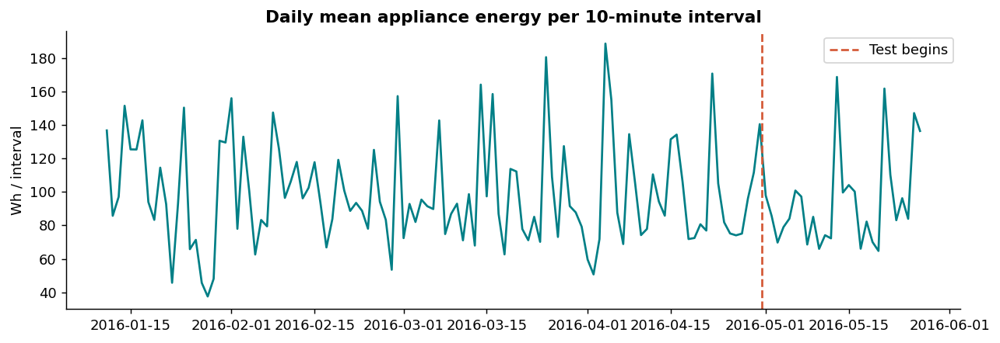
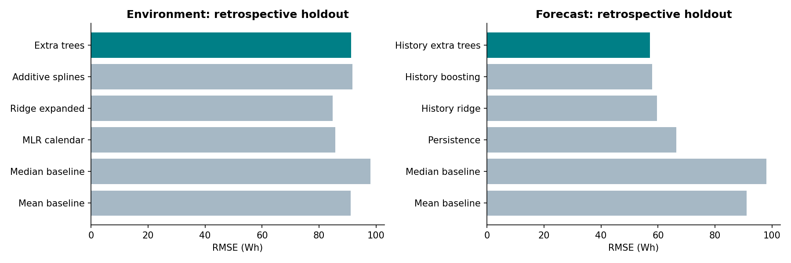

# WattWise

### Regression-based Household Appliances Energy Consumption Prediction, with a test on Temporal Generalization

Author: Swayam Shakya · Python · Jupyter 

WattWise investigates a focused question: **How well can multiple linear regression estimate appliance energy consumption from environmental measurements on a later period?** It uses the real UCI Appliances Energy Prediction dataset and keeps the full analysis inspectable, from raw measurements to row-level predictions.

The original study adds calendar features, ridge regularization, a nonlinear benchmark, temporal cross-validation, residual diagnostics, uncertainty analysis, and a separately defined rolling forecast. It is a research project with measured strengths and limitations, not a production energy-management product.

## Results

The audit fixed three reproduced defects and evaluated **30 model configurations** with nested chronological validation. All tuning uses development data. Because the final period was already inspected in initial version, new results on it are **retrospective comparisons**, not a newly untouched test.

| Task and recipe | MAE (Wh) | RMSE (Wh) | R² |
| --- | ---: | ---: | ---: |
| Environmental MLR, original | 46.933 | 85.686 | 0.114 |
| Environmental ridge, original/default | 47.222 | 84.708 | 0.134 |
| Environmental extra trees, v2 CV winner | 61.365 | 91.187 | -0.003 |
| Forecast persistence | 26.651 | 66.438 | 0.467 |
| Forecast lagged ridge, original | 26.897 | 60.994 | 0.551 |
| Forecast history ridge, v2 | 27.659 | 59.695 | 0.570 |
| Forecast history boosting, v2 | 25.307 | 58.001 | 0.594 |
| Forecast history extra trees, v2 CV winner | 25.506 | 57.230 | 0.605 |

The new forecasting model reduces RMSE by **6.17%** relative to the original lagged ridge and **13.86%** relative to persistence. Boosting has slightly lower MAE; extra trees wins the declared development RMSE criterion. These units are **Wh per ten-minute interval**, not watts, and R² is not classification accuracy.

The environmental expansion **did not improve** the retrospective final-period score. The development-selected tree model is retained as an explicitly experimental option, and the original ridge remains the default environmental predictor. This does not change which model won the new CV search.

Three outer chronological folds rerun the entire family-and-parameter selection process using three inner folds. The selected history extra-tree model improves over persistence on every outer validation window:

| Outer fold | Selected-model RMSE (Wh) | Persistence RMSE (Wh) |
| --- | ---: | ---: |
| 1 | 66.618 | 72.361 |
| 2 | 61.331 | 70.863 |
| 3 | 60.925 | 72.279 |

These are internal development-validation results, not external household validation. Full candidate and fold evidence is in `results/enhanced/`. The original experiment is preserved in the notebook and `results/v1_reference/`.

## Verification and limitations

The real-data experiments and automated tests passed in the delivery environment. All 13 notebook code cells were executed sequentially through IPython in a fresh Python process, with genuine outputs captured and notebook-schema validation. The full expanded searches were repeated by the notebook. Actual logs and JUnit XML are included. This host rejects Jupyter kernel socket setup, so ordinary Jupyter kernel startup could not be verified here. The standard kernel runner is included for your machine and CI. No Windows/macOS test run or GitHub Actions run is claimed.

Tests cover dataset integrity, malformed inputs, target exclusions, fold separation, past-only lag construction at multiple cutoffs, training-only scaling, every candidate family on real data, independently recomputed metrics, nested predictions, CLI consistency, source hashes, overwrite protection and selection rules. See CHANGELOG.md for the three initially failing regression cases. Small arrays are used only for metric-unit tests; fitted experiments use the actual observations.

Only one dwelling and part of one year are represented. Strong residual dependence, high peak-demand error and correlated predictors restrict interpretation. Coefficients are associations, not causal effects or promises of energy savings. Further tuning requires a new final holdout. The manuscript is prepared for author review and is not peer reviewed or accepted by a journal.

## Attribution and licensing

Software and project documentation: MIT License, copyright 2026 Swayam Shakya. The dataset is separately **CC BY 4.0** and remains credited to Luis Candanedo. See [DATA_LICENSE.md](DATA_LICENSE.md). No raw data were modified. See [CITATION.cff](CITATION.cff) for project citation metadata.

1. Candanedo, L. (2017). *Appliances Energy Prediction* [Dataset]. UCI Machine Learning Repository. https://doi.org/10.24432/C5VC8G
2. Candanedo, L. M., Feldheim, V., & Deramaix, D. (2017). Data driven prediction models of energy use of appliances in a low-energy house. *Energy and Buildings, 140*, 81-97. https://doi.org/10.1016/j.enbuild.2017.01.083
3. [Original research repository](https://github.com/LuisM78/Appliances-energy-prediction-data)
4. [scikit-learn LinearRegression](https://scikit-learn.org/stable/modules/generated/sklearn.linear_model.LinearRegression.html) and [TimeSeriesSplit](https://scikit-learn.org/stable/modules/generated/sklearn.model_selection.TimeSeriesSplit.html).

Additional method references: [scikit-learn lagged-feature forecasting example](https://scikit-learn.org/stable/auto_examples/applications/plot_time_series_lagged_features.html) and [SplineTransformer documentation](https://scikit-learn.org/stable/modules/generated/sklearn.preprocessing.SplineTransformer.html). The project implements its own experiment protocol; the examples are methodological references, not sources of result claims.
